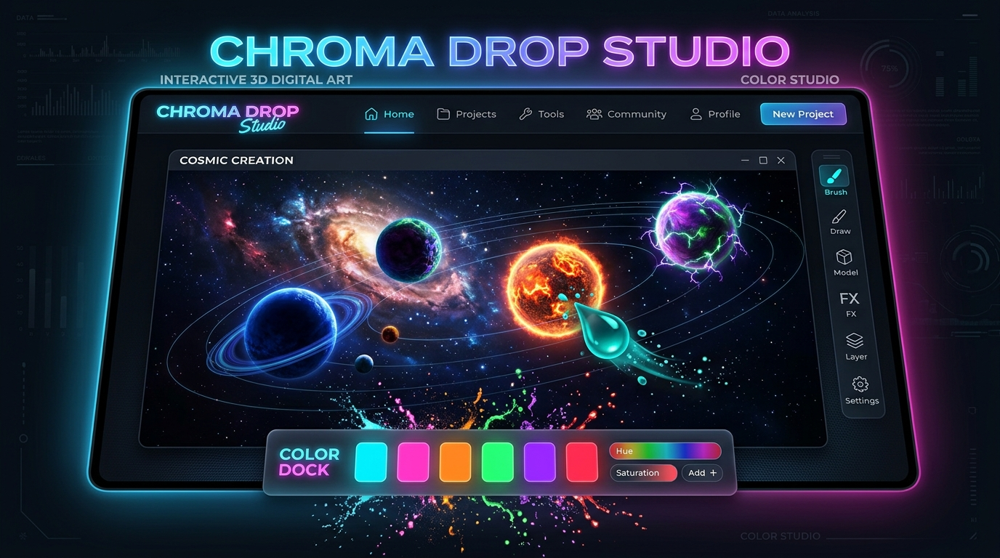

# ChromaDrop Studio 🎨✨
> An interactive 3D digital art and color laboratory built with pure Vanilla JavaScript, CSS3 neo-glassmorphism, and native Web Audio synthesis.

[](https://mahesh-yennam.github.io/ChromaDrop-Studio/)
[](https://github.com/Mahesh-Yennam/ChromaDrop-Studio)



---

## 🌟 Overview
**ChromaDrop Studio** elevates the classic "Pick & Fill" coloring mechanic into a tactile, sensory artboard experience. Featuring fluid liquid physics, 3D glossy shapes, harmonic sound synthesis, and an intuitive **Paint-by-Numbers** guide, users can paint celestial galaxies, crystalline geodes, and organic floral blooms on any device.

---

## ✨ Features

### 🌌 Multi-Scale 3D Shapes & Curated Artboards
Forget identical, repetitive dots. ChromaDrop features multi-scaled 3D glossy spheres, faceted crystals, and organic teardrops with real specular glass curves and shadow refractions:
- **Cosmic Galaxy**: Giant glowing Sun (128px), Saturn with tilted orbit ring, Jupiter, Earth, Mars, and orbiting mini moons (32px).
- **Crystal Geode**: Asymmetrical cluster of large, medium, and small faceted jewel shards.
- **Lotus Bloom**: Large center blossom core with radial teardrop petals and floating morning dew drops.

### 🔢 Intuitive Paint-by-Numbers Mode
- Each shape displays a clean number badge (`1` through `6`).
- Selecting a numbered color causes all matching unpainted shapes to pulse with an inviting **beacon glow aura**.
- Completing all shapes of a number awards that swatch a gold `✓` checkmark and an octave chord chime.
- Completing the whole canvas unleashes a victory fanfare and a 70-particle confetti celebration!

### 🖌️ Free Studio Mode
- One-click toggle in the header switches from guided Paint-by-Numbers to **Free Studio**.
- Numbers, hint pulses, and checkmarks are automatically hidden for clean, unconstrained digital painting.

### 🎵 Native Web Audio Synthesizer Engine
- Zero external audio files or MP3 dependencies.
- Synthesizes water droplet pops on color pick, resonant bass plops on fill, harmonic victory arpeggios, and reverse whooshes on clear.
- Mute/unmute toggle in the header.

### 🎨 Curated Aesthetic Palettes & Studio Tools
- 4 Curated Palettes: **Cyber Neon**, **Pastel Sunset**, **Emerald Oasis**, and **Vibrant Pop**.
- **Native Color Picker**: Full RGB / Hex color spectrum picker for infinite custom shades.
- **Eyedropper Tool (`I`)**: Sample colors directly from any filled shape on the canvas.
- **Continuous Paint Mode (`Space`)**: Hold your active color and rapidly paint across multiple shapes without re-clicking the palette.

### 📱 Responsive & Mobile-First Touch Design
- **Fluid Proportional Scaling**: Dynamically scales the canvas layout to fit screens from 320px wide (iPhone SE) up to ultra-wide desktop monitors without horizontal overflow.
- **Adaptive Ergonomic Dock**: Restructures into an accessible 2-tier thumb deck on mobile screens with safe-area notch insets.
- **Instant Touch Response**: `touch-action: manipulation` eliminates the 300ms mobile tap delay.

### 💾 History & PNG Artwork Export
- Full **Undo (`Ctrl+Z`)** and **Redo (`Ctrl+Y`)** history stack.
- **Export Artwork**: One-click offscreen canvas renderer generates a framed, high-resolution PNG image of your artwork.

---

## ⌨️ Keyboard & Gesture Shortcuts

| Key / Shortcut | Action |
| :--- | :--- |
| `1` — `6` | Select Color Swatches 1 through 6 |
| `Space` | Toggle Continuous Paint Mode (Hold color) |
| `H` | Toggle Numbers Visibility (Show / Hide) |
| `I` | Activate Eyedropper (Sample color from canvas) |
| `Ctrl + Z` | Undo last stroke |
| `Ctrl + Y` | Redo stroke |
| `R` | Randomize / Shuffle colors across the board |
| `C` | Clear canvas back to blank state |
| `Esc` | Deselect active color / Close modals |
| `?` | Open Keyboard Shortcuts guide |

---

## 🛠️ Technology Stack

- **Markup**: Semantic HTML5 (PWA manifest, responsive viewport meta, accessibility tags)
- **Styling**: Modern CSS3 (CSS Variables, Flexbox, Neo-Glassmorphism, Backdrop Filters, Keyframe Animations, Dynamic Viewport Scaling)
- **Logic**: Vanilla ES6+ JavaScript (Event-driven DOM architecture, Undo/Redo stack, Responsive scale calculator)
- **Audio**: Web Audio API (Synthesizer oscillators, gain envelope ramps, frequency modulation)
- **Visual FX**: HTML5 Canvas 2D API (Dynamic particle splash bursts and confetti physics)

---

## 📂 Project Structure

```
Pick & Fill/
├── index.html          # Main HTML structure, header, stage, docks, and modal
├── style.css           # Neo-glassmorphism styles, 3D shapes, animations, and media queries
├── script.js           # Audio engine, particle system, artboard generator, game logic
├── favicon.svg         # 3D liquid droplet vector favicon
├── preview.png         # High-resolution application preview image
├── site.webmanifest    # Web app manifest for PWA bookmarking
├── sitemap.xml         # XML sitemap for search engine indexing
├── robots.txt          # Crawler access rules
└── README.md           # Documentation
```

---

## 🚀 How to Run Locally

Because ChromaDrop Studio is built purely with standard web technologies and zero third-party build steps or dependencies:

1. **Direct Double-Click**:
   - Simply double-click `index.html` in your file explorer to open it immediately in Google Chrome, Microsoft Edge, Mozilla Firefox, or Safari.

2. **Using a Local Static Server (Optional)**:
   - If using VS Code: right-click `index.html` and choose **"Open with Live Server"**.
   - Or using Python in terminal:
     ```bash
     python -m http.server 3000
     ```
     Then navigate to `http://localhost:3000`.
